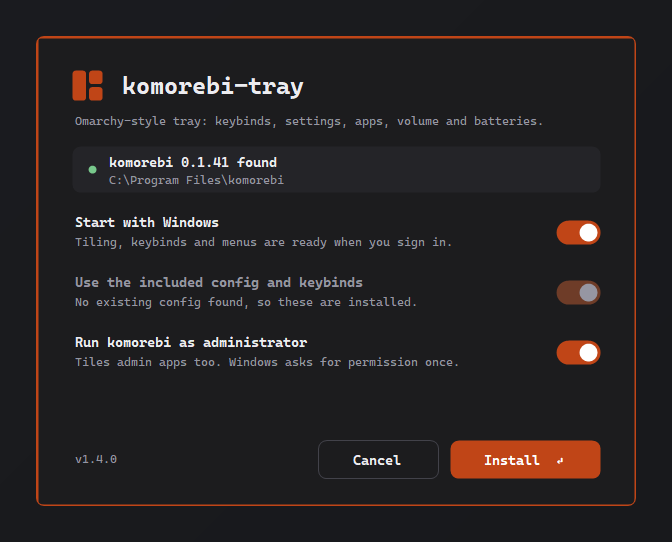
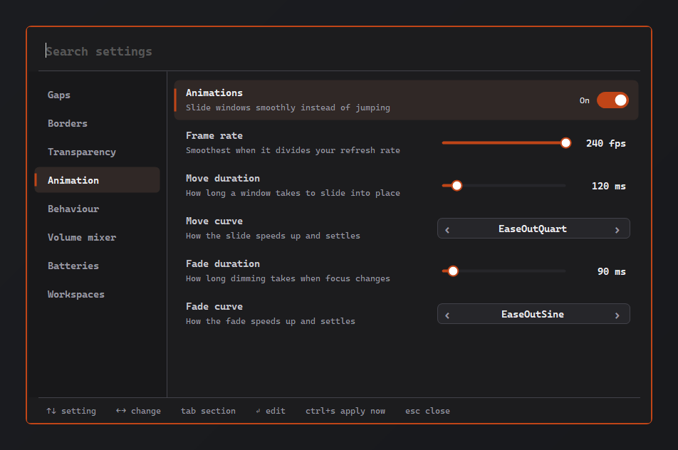
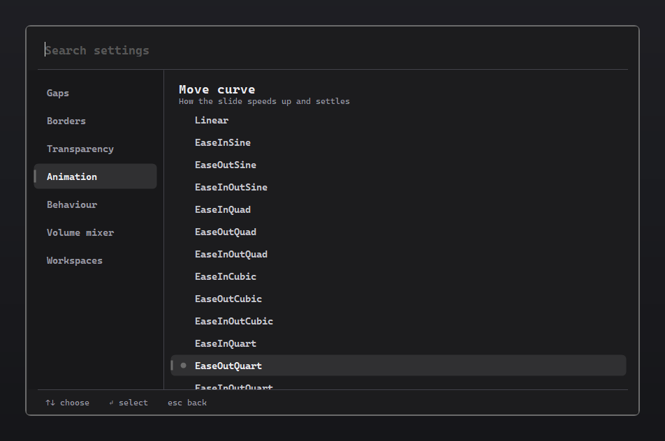
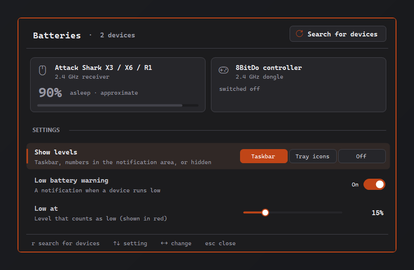
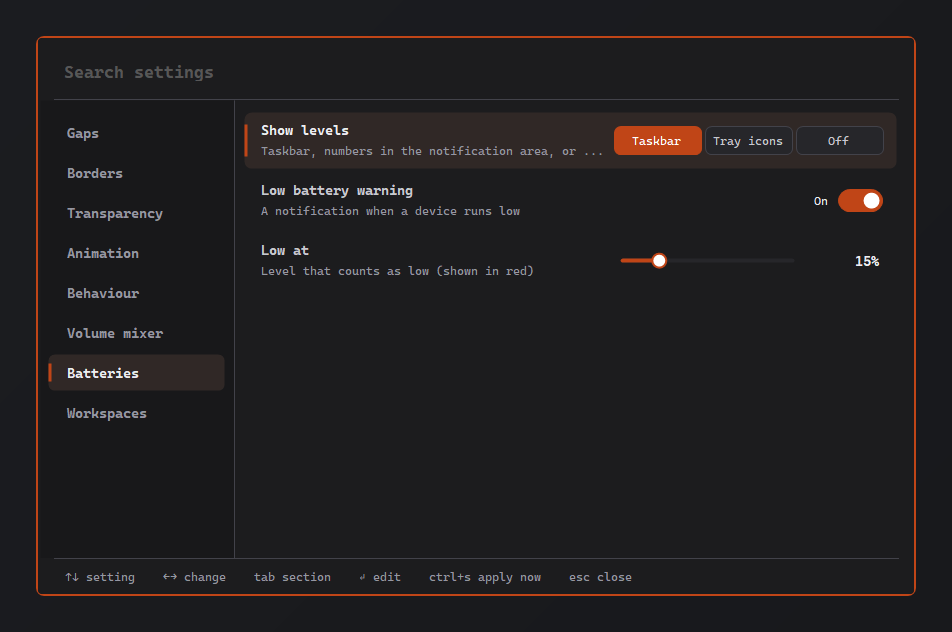
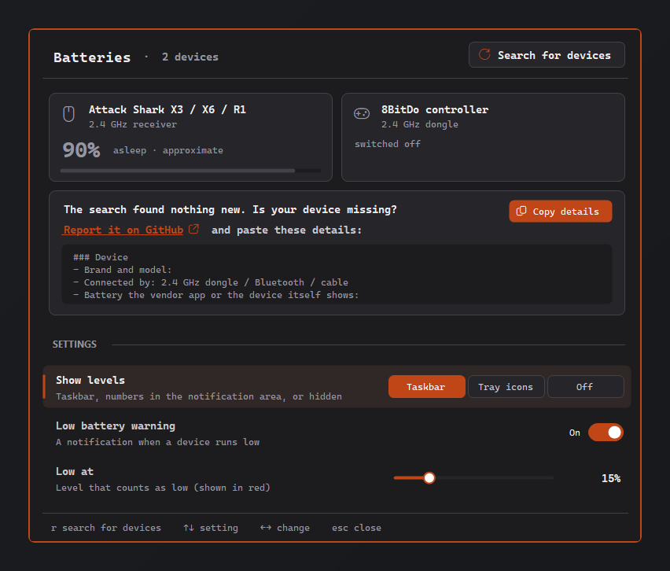

<p align="center">
  
</p>

<h1 align="center">komorebi-tray</h1>

<p align="center">
  An Omarchy-inspired companion for the <a href="https://github.com/LGUG2Z/komorebi">komorebi</a> tiling window manager on Windows:<br>
  built-in hotkeys, a keybind editor, a settings screen, an app launcher, a volume mixer and the battery level of every wireless device on your taskbar, all in one small tray app.
</p>

<p align="center">
  
</p>

> [!NOTE]
> **komorebi-tray is an unofficial add-on.** komorebi is created and maintained by [LGUG2Z](https://github.com/LGUG2Z) and contributors; this project is not affiliated with or endorsed by them.
> komorebi itself is **not modified and not included** here: the installer downloads it from its official winget package, and the tray only talks to it through komorebi's own `komorebic` command line.

## Contents

- [What it adds on top of komorebi](#what-it-adds-on-top-of-komorebi)
- [Install](#install)
- [Default keybinds](#default-keybinds)
- [The menus](#the-menus)
- [Wireless batteries](#wireless-batteries) · [supported devices](#supported-devices) · [a device is missing](#a-device-is-missing-or-reads-wrong)
- [Using it](#using-it)
- [Troubleshooting](#troubleshooting)
- [Build from source](#build-from-source)

## What it adds on top of komorebi

komorebi does the tiling. komorebi-tray wraps it in a keyboard-first desktop experience inspired by [Omarchy](https://omarchy.org):

| | Plain komorebi | With komorebi-tray |
|---|---|---|
| **Hotkeys** | A separate hotkey daemon (whkd or AutoHotkey) | Registered by the tray itself: one process, nothing to keep running alongside |
| **Changing keybinds** | Edit `whkdrc` by hand and restart whkd | **Alt+K**: a searchable list; press a new combo to rebind in place, pick actions from a menu |
| **Changing settings** | Edit `komorebi.json` by hand | **Alt+C**: a settings screen with switches, sliders and colour pickers; changes apply live |
| **Launching apps** | Start menu | **Alt+Space**: a launcher that searches every installed app, with icons, and keeps no history |
| **Volume** | Windows' quick settings | **Alt+Shift+T**: a compact mixer for your output and every app playing sound |
| **Wireless batteries** | One vendor app per brand, each running in the background | Every wireless mouse, keyboard, controller and headset on the taskbar, read straight from the devices; **Alt+Shift+B** for the details |
| **Turning it off** | `komorebic stop` (hotkeys keep running) | One click on the tray icon stops or starts *everything*: tiling, borders, hotkeys and menus |
| **Claude desktop** | Its frameless window is left floating | Tiled while you chat or code; tiling pauses while Claude controls the computer, so nothing fights its window |
| **Crashes** | Windows can be left semi-transparent or untileable | The tray clears leftover transparency and restarts komorebi automatically, and starts it again if it doesn't come up after sign-in |
| **Admin apps** | Can't be tiled unless komorebi runs elevated | Optional admin mode, set up once by the installer; no UAC prompt at each start |
| **Look** | Your own config | A tuned default: gaps, rounded orange borders, focus transparency and smooth animations. The focused border and every menu can follow your Windows accent colour |

## Install

1. Download **`komorebi-tray-setup.exe`** from the [latest release](../../releases/latest).
2. Run it (no admin needed) and choose **Install** (or **Update** when it's already installed).
3. That's it: komorebi starts tiling, the shortcuts work, and the battery levels of your wireless devices appear on the taskbar. Press **Alt+K** to see every shortcut.

 

The installer:

- installs komorebi from its official winget package (`LGUG2Z.komorebi`) if it isn't installed yet;
- copies the tray to `%USERPROFILE%\.config\komorebi\tray` and adds Start menu and (optionally) sign-in shortcuts;
- installs the default `komorebi.json` and keybinds when you have none, or, if you choose to, replaces yours after backing them up as `*.before-komorebi-tray-<date>`;
- on an update keeps your keybinds, and adds the shortcuts of new features when their keys are still free (Alt+Shift+B for batteries);
- can set up **admin mode**: two on-demand scheduled tasks that start komorebi elevated (so it can also tile apps that run as administrator) and end it if it doesn't exit after a stop. Windows asks for permission once;
- registers itself in **Settings → Apps**, where you can uninstall it.

Running it again updates the tray and leaves your config alone unless you ask otherwise. For scripted installs: `komorebi-tray-setup.exe /S`.

> The exe isn't code-signed, so Windows SmartScreen may warn the first time ("More info → Run anyway"). All the source is in this repo, and you can build it yourself (below).

**Requirements:** Windows 10 or 11, 64-bit. .NET Framework 4.8 (built into Windows). Nothing else: no vendor software, no runtime, no service.

## Default keybinds

Mod key is **Alt** (Windows reserves most Win-key combos). Change any of them with **Alt+K**.

| Keys | Action |
|---|---|
| `Alt + Enter` | Open Windows Terminal |
| `Alt + Shift + Enter` | Bring your browser to the front (or start it, restoring your tabs) |
| `Alt + Space` | App launcher |
| `Alt + K` | Keybind editor |
| `Alt + C` | Settings |
| `Alt + Shift + T` | Volume mixer |
| `Alt + Shift + B` | Batteries |
| `Alt + W` | Close window |
| `Alt + T` | Toggle floating |
| `Alt + F` | Toggle fullscreen (monocle) |
| `Alt + Shift + F` | Toggle maximize |
| `Alt + J` / `Alt + Shift + J` | Flip layout horizontally / vertically |
| `Alt + ←↑→↓` | Focus window |
| `Alt + Shift + ←↑→↓` | Move / swap window |
| `Alt + Ctrl + ←↑→↓` | Resize window |
| `Alt + B` / `G` / `V` / `Shift + C` | Layout: BSP / grid / vertical stack / columns |
| `Alt + 1…5` | Go to workspace |
| `Alt + Shift + 1…5` | Move window to workspace |
| `Alt + .` / `Alt + Shift + .` | Focus next monitor / move window to next monitor |
| `Alt + Shift + P` | Pause / resume tiling |
| `Alt + Shift + O` | Reload hotkeys |

Keybinds are stored in the standard whkd format at `%USERPROFILE%\.config\whkdrc`, so they stay readable and portable.

## The menus

Every menu shares one look: a dark panel with an accent outline (komorebi-tray's orange, or your Windows accent while *Match Windows accent* is on), monospace text and a key-hint footer. They fade in at the centre of the screen, and their shortcut, Esc or a click away closes them again.

**Alt+K: keybindings.** Type to filter. Press Enter on a row and then the new keys to rebind it; Tab changes what a shortcut does; Ctrl+N adds one.


**Alt+Space: app launcher.** Type a few letters of any installed app and press Enter. It shows icons and keeps no history.


**Alt+C: settings.** Every komorebi.json option the tray knows, in plain English, grouped into sections. Dependent settings dim when their switch is off, and the search box finds anything across sections.






**Alt+Shift+T: volume mixer.** The default output's level, output switch and mute, a rotary knob, and one slider per app playing sound.


**Alt+Shift+B: batteries.** Every wireless device with its level, the battery settings, and a search for devices that were just plugged in or paired. See [Wireless batteries](#wireless-batteries).



## Wireless batteries

The battery level of every supported wireless mouse, keyboard, controller and headset sits on the taskbar, right next to the notification area, in the same font and size as the clock:


- **Red** at the low mark (15% by default), an **accent-coloured bolt** while charging, **dimmed** while the device sleeps (it then shows the last level it had, also after a restart).
- **Click it**, or press **Alt+Shift+B**, for the Batteries window: a bigger view of every device, including ones that are found but can't report a level (and why), and the battery settings.
- A **notification** when a device runs low (once per discharge; switch it off in the settings).
- Prefer numbers in the notification area? **Show levels → Tray icons** gives each device its own small number icon there; **Off** hides them.

The settings are in the Batteries window and in **Alt+C → Batteries**:



**Accurate, without draining your devices.** Every device is read the cheapest way that still gives its real level, and nothing is polled for nothing:

- Receivers that announce the level by themselves (Attack Shark / Delux) are only *listened to*: nothing is ever sent to the mouse.
- Levels that Windows or the device's driver already knows (Bluetooth, Xbox) are read from Windows: no radio traffic at all.
- Controllers that already send their battery to a running game (Switch mode, DualShock, DualSense) are listened to; a request is only sent when nothing is coming in.
- Devices that have to be asked (Logitech, Razer, the AJAZZ / AULA dongle) are asked once every 3 minutes: one tiny request, a negligible fraction of the radio traffic the mouse or keyboard sends anyway. A device that is asleep is asked again after a minute, so its level is back right after it wakes up.
- The list of devices is only rebuilt when Windows reports that something was plugged in, unplugged, paired or switched off.
- No vendor software needs to run (it can; they don't conflict).

### Supported devices

| Devices | Connection | How the level is read | Precision | Checked |
|---|---|---|---|---|
| **Attack Shark** X3, X6, R1, X3 Max, X11, V3 Pro; **Delux** M900 Pro, and other mice on a Xenta receiver | 2.4 GHz receiver | The receiver's own status broadcasts (read-only) | 1%; X3 / X6 / R1 report steps of 10%, shown as "approximate" | continuously, passively |
| **AJAZZ** AK820, AK980 and other SONiX keyboards; **AULA** F108 Pro | 2.4 GHz dongle | The dongle's battery command (only answered in 2.4 GHz mode) | 1% | every 3 min |
| **8BitDo** pads in Switch mode, **Nintendo** Pro Controller, Joy-Con | Bluetooth | The battery field of the controller's reports, or one device-info request | 4 steps (25%) | every 3 min |
| **Logitech** mice, keyboards and headsets with HID++ 2.0 | Unifying, Lightspeed and Bolt receivers; Bluetooth | Unified Battery, Battery Status or Battery Voltage | 1% (voltage-only devices: estimated) | every 3 min |
| **Razer** wireless mice, keyboards and headsets | dongle / cable | The battery command | ~1% | every 3 min |
| **Sony** DualShock 4, DualSense, DualSense Edge | USB; Bluetooth while a game or Steam uses the pad | The status byte in the pad's own reports | 10% | every minute, passively |
| **Xbox** controllers and their headsets | Xbox Wireless adapter, Bluetooth | XInput (Windows' Xbox driver) | 4 levels | every minute |
| **Any Bluetooth device** Windows shows a battery for (headphones, earbuds, mice, keyboards, pads) | Bluetooth | The level Windows itself keeps | as Windows reports it | every minute |

**Not available:** **8BitDo** pads on their **2.4 GHz dongle** (e.g. Ultimate 2C) tell Windows they are a wired Xbox 360 pad and send no battery level, and their vendor channel has no published battery command. They are listed as found, with that explanation; switch the pad to Switch mode over Bluetooth to get its level.

**Tested on real hardware so far:** Attack Shark X3 (2.4 GHz receiver) and 8BitDo Ultimate 2C (2.4 GHz dongle). The other readers follow the published protocols (see [Credits](#credits)); if one reads wrong for you, please [report it](#a-device-is-missing-or-reads-wrong).

### A device is missing or reads wrong

1. Press **Alt+Shift+B** and click **Search for devices** (or press **R**). This builds the device list again and asks every device straight away, which also finds a device that was plugged in or paired a moment ago.
2. Still not there? The window then shows **Report it on GitHub**. Click it: the details komorebi-tray needs are copied to your clipboard and a new issue opens. Paste them, and fill in the first three lines (brand and model, how it's connected, what the vendor app shows). **Copy details** copies them without opening the issue.



The copied details list the version, your Windows version, what komorebi-tray reads, and the USB / HID devices it can see (vendor and product ids). Bluetooth device names are left out, since they often contain your name:

```
### Device
- Brand and model:
- Connected by: 2.4 GHz dongle / Bluetooth / cable
- Battery the vendor app or the device itself shows:

### System
- komorebi-tray 1.4.0
- Windows 11 Pro 24H2 (build 26100.4061)

### What komorebi-tray reads
- Attack Shark X3 / X6 / R1: about 90% (2.4 GHz receiver)

### USB / HID devices
1D57:FA60  if 2   000A:0000  in 5   out 0    feat 0    2.4G Wireless Device
…
```

From a terminal, `komorebi-tray.exe --battery-list` prints one reading of every device.

## Using it

- **Tray icon:** white while running, grey while stopped. Left-click stops or starts everything; right-click opens the menu (settings, keybinds, volume mixer, batteries, reload config, save diagnostics, quit).
- **Menus** (Alt+K, Alt+C, Alt+Space, Alt+Shift+T, Alt+Shift+B) fade in and out; press their shortcut again, Esc, or click away to close them.
- **Volume mixer** (Alt+Shift+T, or *Volume mixer* in the tray menu): opens at the top centre of the monitor your mouse is on (from the menu: under the tray icon). Drag the display, turn the knob (drag around it like a real knob, or scroll over it) to set the volume; the two buttons beside it switch to your next output and mute it. Each app playing sound gets its own slider; click its icon to mute it. Arrow keys adjust, M mutes, Esc or a click away closes it. Alt+C → Volume mixer chooses whether quiet apps are listed. It talks to Windows' audio directly and does nothing while closed.
- **Batteries** (Alt+Shift+B, *Batteries…* in the tray menu, or a click on the taskbar levels): R searches for devices, ↑↓ picks a setting, ←→ or a click changes it. Changes apply straight away.
- **Keep videos solid** (Alt+C → Transparency, on by default) stops YouTube, Twitch and X from being dimmed when their browser window isn't focused, so a video you're watching on the side stays clear. It goes by the tab in front: a video tab behind another tab in the same window is dimmed like the rest. It covers all of X, not just its videos.
- **Games and fullscreen video:** while a fullscreen window is in front (no title bar, covering its whole monitor), the tray pauses its shortcuts, so keys like Alt+Enter reach the game instead of opening a terminal. They come back the moment you leave it. Turn this off in Alt+C → Behaviour → *Pause shortcuts in fullscreen*. komorebi itself never tiles, dims or draws over fullscreen windows, and neither it nor the tray hooks your keyboard or mouse, so there's no added input delay.
- **Match Windows accent** (Alt+C → Borders) gives the focused window's border, every menu and the charging bolt your Windows accent colour, and follows it live when you change it in Settings → Personalization → Colors. Turning it off brings back the colour you had before. On a light accent, text on accent-coloured buttons turns dark so it stays readable.
- **Alt+C** saves when it closes and makes komorebi reload; **Ctrl+S** applies without closing, and **Ctrl+E** opens the raw `komorebi.json`. Each save keeps the previous file as `komorebi.json.bak`. The tray's own choices (accent, batteries, mixer) live in `komorebi-tray.json` next to it.
- **Command line:** `komorebi-tray.exe --shortcuts | --settings | --apps | --volume | --batteries | --toggle-pause | --browser | --diagnostics` controls the running tray; `--battery-list` prints the battery levels.

## Troubleshooting

- **An app won't tile:** it's probably running as administrator. Enable admin mode in the installer (run it again), or start that app normally.
- **Windows stay semi-transparent or stop tiling after a crash:** click the tray icon twice (stop, then start). The tray clears leftover transparency and starts komorebi with a clean state.
- **A wireless device isn't listed, or its level looks wrong:** see [A device is missing or reads wrong](#a-device-is-missing-or-reads-wrong). A device that's asleep shows its last level dimmed; it updates within a minute of waking up (mice on a Xenta receiver: within seconds of moving them).
- **No battery levels on the taskbar:** they only show for devices that report a level, and not on a taskbar docked to the left or right of the screen. Alt+Shift+B → *Show levels* must be *Taskbar*; *Tray icons* is the alternative for a vertical taskbar.
- **Claude desktop:** its window is frameless, so komorebi wouldn't tile it on its own. The tray hands Claude's main window to komorebi when it comes to the front, and leaves alone the click-through orange border Claude shows while it controls the computer, so that border stays full-screen above your tiles. While Claude is controlling the computer it stretches its own window over the screen, so the tray pauses tiling for that time and resumes it (every window back in its tile) when Claude is done; if you had paused tiling yourself, it stays paused. Don't add a `manage_rules` entry for `claude.exe`: it can't tell the two windows apart and would tile the border too, rearranging your windows under Claude's clicks.
- **Discord (or another Electron app) never looks dimmed:** it draws through DirectComposition, which ignores window transparency. For Discord, quit it fully (tray icon → Quit), open `%APPDATA%\discord\settings.json` and set `"chromiumSwitches": { "disable-direct-composition": "1" }`, then start it again. It keeps GPU acceleration.
- **A shortcut doesn't work:** another app already owns it. The tray names the conflict in a notification; rebind it with Alt+K.
- **Something else:** right-click the tray icon → *Save diagnostics*, which writes `diag.txt` next to your config, and [open an issue](../../issues/new).

## Build from source

No SDK or Visual Studio needed: the build uses the C# compiler that ships with Windows.

```powershell
.\build.ps1
```

This produces `build\komorebi-tray.exe` and the installer `dist\komorebi-tray-setup.exe`, which embeds the tray, the icon and the files in `config\`.

| Path | What |
|---|---|
| `src\tray.cs` | The tray: hotkeys, menus, settings screen, launcher, komorebi supervision |
| `src\mixer.cs` | The volume mixer |
| `src\battery.cs` | Battery readers for each device family, and the battery thread |
| `src\battery-ui.cs` | The taskbar levels, the tray-icon numbers and the Batteries window |
| `installer\Setup.cs` | The installer / uninstaller |
| `config\` | Default `komorebi.json` and `whkdrc` |
| `assets\` | Icon (`tools\make-icon.ps1` draws it) |
| `tools\screenshots.ps1` | Takes the screenshots in this README from the running tray, in the default orange |

The tray idles at a few MB of memory and close to no CPU (about 15 ms of CPU time per minute, battery levels included): it waits on Windows events instead of polling, and the battery thread wakes every 15 s only to collect what devices already sent.

## Credits

- **[komorebi](https://github.com/LGUG2Z/komorebi)** by [LGUG2Z](https://github.com/LGUG2Z) and contributors: the tiling window manager this project is built around. If you enjoy it, consider [sponsoring komorebi's development](https://github.com/sponsors/LGUG2Z). komorebi is licensed under the [Komorebi License](https://github.com/LGUG2Z/komorebi/blob/master/LICENSE.md).
- **[whkd](https://github.com/LGUG2Z/whkd)** by LGUG2Z: komorebi-tray reads and writes its keybind file format.
- **[Omarchy](https://omarchy.org)** by DHH: the inspiration for the look and the keyboard workflow.
- **Battery protocols:** the battery readers are written for this project from public protocol notes: [omarchy-delux-m900](https://github.com/AeonArcHQ/omarchy-delux-m900) and [BatteryTray](https://github.com/qu1ncky/BatteryTray) (Xenta receivers), [Nintendo Switch Reverse Engineering](https://github.com/dekuNukem/Nintendo_Switch_Reverse_Engineering) (Pro Controller), [sonix-keyboard-studio](https://github.com/donglover69/sonix-keyboard-studio) (SONiX dongles), [Solaar](https://github.com/pwr-Solaar/Solaar) and Logitech's HID++ 2.0 documents, [OpenRazer](https://github.com/openrazer/openrazer), and the Linux kernel's `hid-playstation` driver. The idea of a taskbar battery readout for every brand comes from [Wireless Battery](https://github.com/krisgfx9/Wireless-Device-Battery-Monitor) by krisgfx9.

## License

komorebi-tray's own code is released under the [MIT License](LICENSE). That covers only the code in this repository; komorebi and whkd keep their own licenses.
