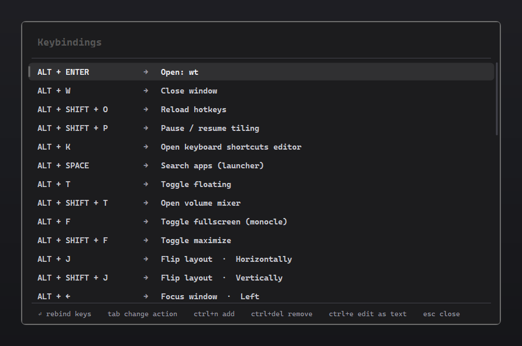
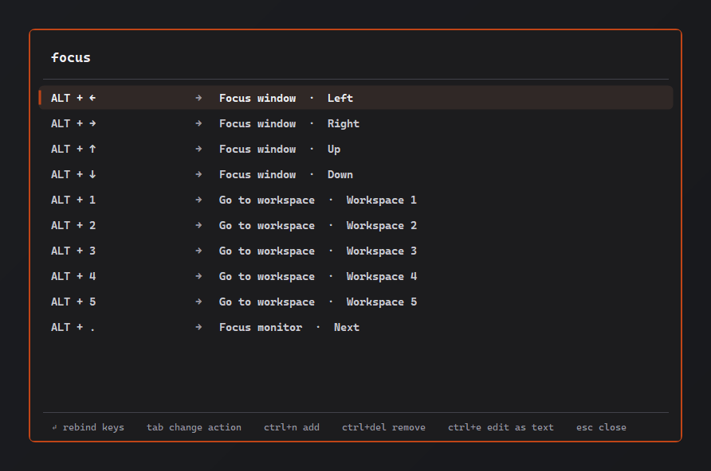
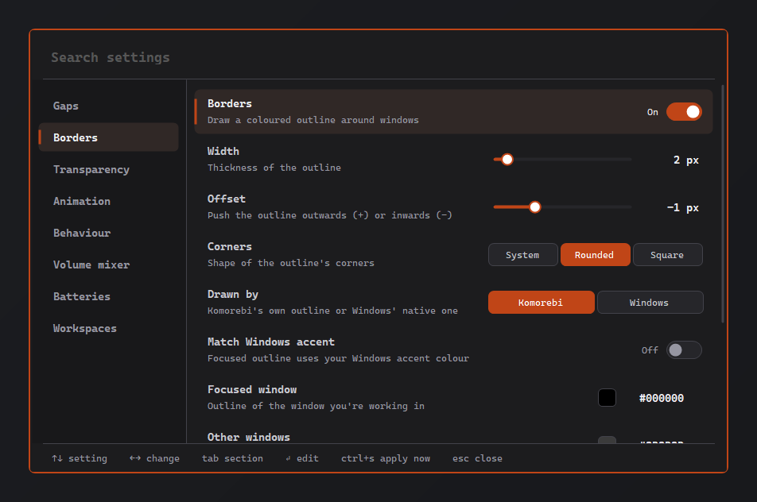
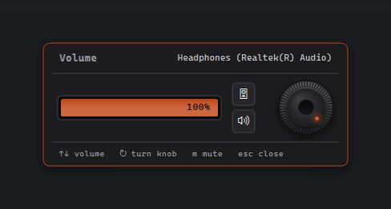

<p align="center">
  
</p>

<h1 align="center">komorebi-tray</h1>

<p align="center">
  An Omarchy-inspired companion for the <a href="https://github.com/LGUG2Z/komorebi">komorebi</a> tiling window manager on Windows:<br>
  built-in hotkeys, a keybind editor, a settings screen, an app launcher, a volume mixer and the battery level of every wireless device on your taskbar, all in one small tray app.
</p>

<p align="center">
  
</p>

> [!NOTE]
> **komorebi-tray is an unofficial add-on.** komorebi is created and maintained by [LGUG2Z](https://github.com/LGUG2Z) and contributors; this project is not affiliated with or endorsed by them.
> komorebi itself is **not modified and not included** here: the installer downloads it from its official winget package, and the tray only talks to it through komorebi's own `komorebic` command line.

## Contents

- [What it adds on top of komorebi](#what-it-adds-on-top-of-komorebi)
- [Install](#install)
- [Default keybinds](#default-keybinds)
- [The menus](#the-menus)
- [Wireless batteries](#wireless-batteries) · [supported devices](#supported-devices) · [a device is missing](#a-device-is-missing-or-reads-wrong)
- [Using it](#using-it)
- [Troubleshooting](#troubleshooting)
- [Build from source](#build-from-source)

## What it adds on top of komorebi

komorebi does the tiling. komorebi-tray wraps it in a keyboard-first desktop experience inspired by [Omarchy](https://omarchy.org):

| | Plain komorebi | With komorebi-tray |
|---|---|---|
| **Hotkeys** | A separate hotkey daemon (whkd or AutoHotkey) | Registered by the tray itself: one process, nothing to keep running alongside |
| **Changing keybinds** | Edit `whkdrc` by hand and restart whkd | **Alt+K**: a searchable list; press a new combo to rebind in place, pick actions from a menu |
| **Changing settings** | Edit `komorebi.json` by hand | **Alt+C**: a settings screen with switches, sliders and colour pickers; changes apply live |
| **Launching apps** | Start menu | **Alt+Space**: a launcher that searches every installed app, with icons, and keeps no history |
| **Volume** | Windows' quick settings | **Alt+Shift+T**: a compact mixer for your output and every app playing sound |
| **Wireless batteries** | One vendor app per brand, each running in the background | Every wireless mouse, keyboard, controller and headset on the taskbar, read straight from the devices; **Alt+Shift+B** for the details |
| **Turning it off** | `komorebic stop` (hotkeys keep running) | One click on the tray icon stops or starts *everything*: tiling, borders, hotkeys and menus |
| **Claude desktop** | Its frameless window is left floating | Tiled while you chat or code; tiling pauses while Claude controls the computer, so nothing fights its window |
| **Crashes** | Windows can be left semi-transparent or untileable | The tray clears leftover transparency and restarts komorebi automatically, and starts it again if it doesn't come up after sign-in |
| **Admin apps** | Can't be tiled unless komorebi runs elevated | Optional admin mode, set up once by the installer; no UAC prompt at each start |
| **Look** | Your own config | A tuned default: gaps, rounded orange borders, focus transparency and smooth animations. The focused border and every menu can follow your Windows accent colour |

## Install

1. Download **`komorebi-tray-setup.exe`** from the [latest release](../../releases/latest).
2. Run it (no admin needed) and choose **Install** (or **Update** when it's already installed).
3. That's it: komorebi starts tiling, the shortcuts work, and the battery levels of your wireless devices appear on the taskbar. Press **Alt+K** to see every shortcut.

 

The installer:

- installs komorebi from its official winget package (`LGUG2Z.komorebi`) if it isn't installed yet;
- copies the tray to `%USERPROFILE%\.config\komorebi\tray` and adds Start menu and (optionally) sign-in shortcuts;
- installs the default `komorebi.json` and keybinds when you have none, or, if you choose to, replaces yours after backing them up as `*.before-komorebi-tray-<date>`;
- on an update keeps your keybinds, and adds the shortcuts of new features when their keys are still free (Alt+Shift+B for batteries);
- can set up **admin mode**: two on-demand scheduled tasks that start komorebi elevated (so it can also tile apps that run as administrator) and end it if it doesn't exit after a stop. Windows asks for permission once;
- registers itself in **Settings → Apps**, where you can uninstall it.

Running it again updates the tray and leaves your config alone unless you ask otherwise. For scripted installs: `komorebi-tray-setup.exe /S`.

> The exe isn't code-signed, so Windows SmartScreen may warn the first time ("More info → Run anyway"). All the source is in this repo, and you can build it yourself (below).

**Requirements:** Windows 10 or 11, 64-bit. .NET Framework 4.8 (built into Windows). Nothing else: no vendor software, no runtime, no service.

## Default keybinds

Mod key is **Alt** (Windows reserves most Win-key combos). Change any of them with **Alt+K**.

| Keys | Action |
|---|---|
| `Alt + Enter` | Open Windows Terminal |
| `Alt + Shift + Enter` | Bring your browser to the front (or start it, restoring your tabs) |
| `Alt + Space` | App launcher |
| `Alt + K` | Keybind editor |
| `Alt + C` | Settings |
| `Alt + Shift + T` | Volume mixer |
| `Alt + Shift + B` | Batteries |
| `Alt + W` | Close window |
| `Alt + T` | Toggle floating |
| `Alt + F` | Toggle fullscreen (monocle) |
| `Alt + Shift + F` | Toggle maximize |
| `Alt + J` / `Alt + Shift + J` | Flip layout horizontally / vertically |
| `Alt + ←↑→↓` | Focus window |
| `Alt + Shift + ←↑→↓` | Move / swap window |
| `Alt + Ctrl + ←↑→↓` | Resize window |
| `Alt + B` / `G` / `V` / `Shift + C` | Layout: BSP / grid / vertical stack / columns |
| `Alt + 1…5` | Go to workspace |
| `Alt + Shift + 1…5` | Move window to workspace |
| `Alt + .` / `Alt + Shift + .` | Focus next monitor / move window to next monitor |
| `Alt + Shift + P` | Pause / resume tiling |
| `Alt + Shift + O` | Reload hotkeys |

Keybinds are stored in the standard whkd format at `%USERPROFILE%\.config\whkdrc`, so they stay readable and portable.

## The menus

Every menu shares one look: a dark panel with an accent outline (komorebi-tray's orange, or your Windows accent while *Match Windows accent* is on), monospace text and a key-hint footer. They fade in at the centre of the screen, and their shortcut, Esc or a click away closes them again.

**Alt+K: keybindings.** Type to filter. Press Enter on a row and then the new keys to rebind it; Tab changes what a shortcut does; Ctrl+N adds one.



**Alt+Space: app launcher.** Type a few letters of any installed app and press Enter. It shows icons and keeps no history.


**Alt+C: settings.** Every komorebi.json option the tray knows, in plain English, grouped into sections. Dependent settings dim when their switch is off, and the search box finds anything across sections.




**Alt+Shift+T: volume mixer.** The default output's level, output switch and mute, a rotary knob, and one slider per app playing sound.



**Alt+Shift+B: batteries.** Every wireless device with its level, the battery settings, and a search for devices that were just plugged in or paired. See [Wireless batteries](#wireless-batteries).


## Wireless batteries

The battery engine is a C# port of [Wireless Battery](https://github.com/krisgfx9/Wireless-Device-Battery-Monitor) by krisgfx9 (GPL-3.0): the same device drivers, the same taskbar readout, and the same tray icons and menu, built into the tray instead of running as a separate app. It reads every device exactly as the original does (one deliberate change: Xenta model code `0x10` is named *Attack Shark X3 / X6 / R1*, since the X3 reports that code too).

**On the taskbar (default):** an icon and the percentage for each device, next to the notification area, drawn with the Windows icon font:


- **Red** number: at or below the low mark (15% by default). **Blue bolt:** charging. **Dimmed:** asleep, showing the last known value.
- Follows light / dark mode and DPI scaling, steps around the Windows 11 Widgets button and Windows 10's News and Interests, and narrows the Windows 10 task buttons so they don't run under it.
- **Transparent taskbar themes** (e.g. Windhawk's Taskbar Styler): turn on *Background behind taskbar text* to keep it readable over the wallpaper.
- **Hover** for every device's details; **click** for the menu: every device (click one to hide or show it), *Hide last known / asleep devices*, taskbar or tray icons, the background option, *Refresh now* and the Batteries window.

**Tray icons:** one icon per device in the notification area, the number drawn large with a level bar underneath (green, orange from 30%, red at the low mark, blue while charging). Used automatically when the taskbar is vertical or can't be found; choose it yourself with *Show levels → Tray icons*. Windows 11 puts new tray icons in the overflow (^) until you drag them onto the taskbar.

A **notification** warns once when a device drops to the low mark, and again only after it has charged 10% above it (switch it off in the settings). Levels refresh every 60 seconds, and right away when a device is plugged in or unplugged or the PC wakes up.

**Alt+Shift+B** opens the Batteries window: a bigger card for every device (click one to hide or show it on the taskbar), a search for devices, and the battery settings, which are also in **Alt+C → Batteries**:


### Supported devices

| Vendor | Devices | How |
|---|---|---|
| **Logitech** | Mice and keyboards on Unifying, Bolt, Lightspeed (including the PRO X3 SUPERSTRIKE dongle `046D:C54F`) and Nano receivers, over USB or Bluetooth; G headsets (G533, G535, G633/G635/G733/G933/G935, G PRO/PRO X); G435 on the newer `046D:0ADF` dongle | HID++ 1.0 / 2.0 with feature discovery: unified battery, battery level, voltage, ADC; G435: CRC-16 framed vendor reports, `GET_BATTERY` in mV |
| **Razer** | Wireless mice, keyboards and dongles; BlackShark V2 HyperSpeed, V2 Pro (2023), V3 / V3 Pro / V3 X headsets; Barracuda X (2022) on its 2.4 GHz receiver (`1532:0550`) | Razer feature-report protocol; BlackShark vendor protocols (V3 / V3 Pro / V3 X queried every 5 min); Barracuda X: Airoha battery and cable queries through the receiver |
| **SteelSeries** | Arctis 1/7/7+/9/Pro/Pro Wireless, Arctis Nova 3P/5/7/7X/7P/Pro Wireless (including `1038:225D`), GameBuds; Aerox 3/5/9 Wireless, Prime Wireless, Rival 3 Wireless (Gen 2), Rival 650, Rival Pro | Vendor HID reports |
| **Corsair** | Void / Void Pro / Void Elite / HS70 / HS80 wireless; Bragi devices (Virtuoso, Void V2, HS80 MAX, Slipstream mice and keyboards, including the newer Slipstream receiver `1B1C:2B00`, e.g. Scimitar Elite SE Wireless) | Vendor HID reports, Bragi `GET` (read-only) |
| **Cooler Master** | MM712, MM731 (2.4 GHz dongle or USB cable) | Vendor HID status report (read-only) |
| **HyperX** | Cloud III Wireless, Cloud III S Wireless, Cloud II Wireless (HP, Kingston, DTS), Cloud II Core Wireless, Cloud Alpha Wireless, Cloud Alpha 2 Wireless, Cloud Flight, Cloud Flight S, Cloud Stinger Core Wireless | Vendor HID reports |
| **Glorious** | Model O / O- / D / D- Wireless, Model O 2 / D 2 PRO | Vendor feature report |
| **Hitscan** | Hyperlight X, Hyperlight N | Vendor feature report (same protocol as Glorious) |
| **Kysona / Pulsar / ATK (VXE) / Hitscan** | Kysona M600 / Mercury, Pulsar and ATK VXE wireless mice (e.g. VXE X3 Pro, VXE Dragonfly R1 / R1 Pro Max / R1 SE+, ATK F1 Extreme), Hitscan Hyperlight | Shared vendor protocol with checksummed replies |
| **Pulsar X2 V3** | X2 V3 on the 1K dongle (`3710:5402`) or USB cable (`3710:3402`); X2 V3 eS on the 8K dongle (`3710:5403`) or USB cable (`3710:3406`) | 64-byte vendor feature report, battery register `08 81 01` (read-only) |
| **ATK / VXE NK** | VXE R1 NK and other NearLink mice on the NK mouse NANO dongle (`373B:1216`) | ATK BITMOUSE output report 08 on `FF05:0001` (battery and charging) |
| **ATK headsets** | ATK N9 Pro, N9 Ultra (first generation) | Virtual COM port protocol (the ATK desktop app must be closed) |
| **G-Wolves** | Fenrir, Fenrir Pro / Max / Asym, HTX, HTS, HSK, HTR, HT-S2, Lycan, WARG, VUK and their 8K dongles | Glorious or Kysona protocol, depending on the model |
| **Keychron mice** | M4 and other Keychron mice on the 2.4 GHz receiver; 4K mice (M4 4K, M3 4K, M3 mini 4K, M6 4K ...) on the Keychron 4K Link receiver (`3434:D038`); 8K mice (M5 8K, G6 HE 8K ...) on the TurboLink 8K receiver; Nape Pro trackball on the Link-KM receiver or cable | Vendor report from Keychron Launcher (Nape Pro: raw HID A7 31) |
| **LAMZU** | Maya X, Maya, Maya M, Tachi, Inca, Paro, Thorn, Atlantis Mini / OG Champion, Orcus (cable, 1K and 4K/8K dongles) | Vendor feature report from LAMZU Aurora |
| **Endgame Gear** | OP1w 4k (v1 / v2), XM2w 4k (v1 / v2) on the 4K dongle | Vendor feature report `A1`, battery command `B4` (read-only) |
| **WLMouse** | YING Magnesium (YING 8K receiver `36A7:A874`); Beast X 8K, Beast X Mini / Mini Pro, Beast X Pro, Beast MAX, Sword X 8K (receiver or cable; not the Beast X 4K); Beast X V2 (8K receiver `36A7:A856`) | Vendor feature report, status command `0x83` (YING: same protocol as Glorious) |
| **VAXEE** | Wireless mouse on the VAXEE 4K receiver (`3057:1002`); ZYGEN NP-01S V2 Wireless over USB cable (`3057:1011`) | Read-only vendor feature report `0E` on `FF05:0001`; battery in 5% steps, charging state ([protocol notes](docs/vaxee.md)) |
| **HECATE** | G5M PRO and other HECATE mice on the same receiver, and USB cable `35BB:D3FA / D3FC / D3FD` | Kysona protocol |
| **Redragon** | Compx-based wireless mice: M916 Pro 1K (tested), M913 Impact Elite (tri-mode), G49 (receiver or cable) | Kysona protocol (the Areson `25A7` receivers are listed under Areson) |
| **Taidu (钛度)** | TSG808 on its Compx 2.4 GHz receiver `3554:F5D5` (tested) | Kysona protocol |
| **Areson (Redragon)** | M915RGB-WL (tested), original M913 Impact Elite and other mice on the `25A7:FA07` / `FA08` receiver | 17-byte `GetPower` feature report; level in 10% steps and a charging flag |
| **Ninjutso** | Sora V2 on the 1K receiver (`1915:AE1C`, tested) | NinjaForce feature report 0x05, status command 0x15; battery, online and charging state |
| **Sprime** | PM1 on the 2.4 GHz receiver (`1915:AC1C`, tested; `1915:AD8C`) or USB cable | Same feature report 0x05, status command 0x15, from Sprime's web driver (sprime.pro) |
| **AULA** | F75 / F87 Pro / F99 wireless keyboards on the 2.4 GHz receiver | Report 0x13 frame, command 0x4A, sum checksum (Bluetooth and wired modes untested) |
| **DAREU** | EM901X on the `260D:1074` 2.4 GHz receiver (battery reading tested; charging transitions untested) | Battery-only feature report `08`, command `04`; reply `09` on a separate vendor collection. Requires one unambiguous input/feature pair; USB cable mode and other receiver IDs are not enabled |
| **SONiX keyboards (AJAZZ / AULA)** | AJAZZ AK820 MAX (tested), AULA F108 Pro on the `05AC:024F` 2.4G dongle; AJAZZ AK980 V2 on the `0C45:FEFE` dongle | Vendor report `20 01` on usage page FF60, sum checksum (2.4G mode only) |
| **ZOWIE** | EC1/EC2/EC3-CW, DW series (U2-DW, S2-DW ...) and U2 on its 2.4 GHz receiver | Community-documented read-only vendor commands |
| **Royal Kludge (RK)** | MG6 Pro on the 2.4 GHz dongle (`2E3C:00A6` / `00E6`) or USB cable (`2E3C:00A5` / `00E5`) | QiWang 64-byte frame from RK's web driver, `GET_BATTER_VOL` read (percent, voltage, charging) |
| **ASUS ROG** | Strix Scope II 96 (RX), Azoth, Falchion keyboards; Keris, Harpe, Gladius, Chakram, Spatha, Pugio, Strix Impact mice; Pelta headset (2.4 GHz dongle); the Omni Receiver | ROG HID battery query |
| **MCHOSE** | L7 / L7 Pro / L7 Ultra (L7 Ultra tested), M7 / M7 Ultra, A7 / A7 Ultra, K7 mice on the 2.4 GHz receiver or USB cable; G3 V2 (2.4 GHz receiver `3837:4245` and USB cable `3837:418C`) | Vendor feature report, inverted payload (protocol from alexfrih/mchose-linux); G3 V2: read-only vendor query on `FF01:0010` |
| **AULA / MCHOSE keyboards** | AULA F75 / F87 Pro / F99; MCHOSE K99 V2, G75 Pro, X75 and the other M HUB keyboards on the 2.4 GHz receiver (`3554:FA09`, `41E4:2001`) | Report 0x13 frame, command 0x4A (MCHOSE models identified by command 0x05, as in M HUB); Bluetooth and wired modes not covered |
| **Rapoo VT** | VT3 Max Gen 2 (tested); other Nordic 54L VT mice exposing the same status interface; legacy VT3 Pro (experimental); VT1 Pro Max (from the owner's USB captures) | Passive HID status report `07` on `FF00:0002`; legacy `BB` restricted to VT3 Pro `1215/4415` and VT1 Pro Max `1233/4433`. Receiver and USB cable, with charging state |
| **Motospeed / Delux / Ajazz** | Motospeed X6, Delux M900 Pro, Delux M800 Pro, Ajazz AJ179 family; AJ159 and other AJ-series mice on the 3151 receiver; AJ139 V2 MC (`A8A5:2255` receiver, `A8A4:2255` cable) | Vendor reports (Delux: passive status broadcasts or feature query; AJ-series: 0xF7 status poll, then feature report 0x05) |
| **Incott** | G23 V2 / G24 (`093A:522C` receiver, `093A:622C` cable) | Read-only status feature report 09 |
| **Attack Shark and other Chinese brands** | Rongyuan receivers (81 models: Attack Shark R3, K86, X82 PRO HE, Ajazz keyboards, some MSI and others; the K86 over Bluetooth is shown as a keyboard); Xenta receivers (Attack Shark X3 / X6 / R1, X11, X3 Max, V3 Pro) | Rongyuan status report; Xenta passive broadcasts |
| **Wraith** | W1 / W1 Freestyle (`093A:522C` receiver, `093A:622C` cable; same ids as Incott, told apart by the model code) | Read-only per-button reads `86` (feature report 09) over all buttons, then the pushed status input report 09 |
| **Fantech** | Helios Go XD5 (wired `25A7:FA7B`, 2.4 GHz dongle `25A7:FA7C`) | Vendor feature report `08`, command `04`, sum-to-`0x55` checksum |
| **Sony** | DualShock 4, DualSense, DualSense Edge (USB, Bluetooth, wireless adapter); INZONE H9 II and H5 headsets; INZONE Buds (USB-C dongle) | Input report; INZONE vendor protocol |
| **Fractal Design** | Scape headset on its 2.4 GHz dongle or USB-C cable | Vendor `GET_DEVICE_STATE` query from Fractal's Adjust Pro web app (usage page FF00) |
| **Jabra** | Headsets on a Jabra Link 380a / 380c / 390 dongle (USB-A and USB-C, UC and MS versions: Evolve2 / Evolve3 and others); name read from the headset | GNP status query (class 12 / op 02) on usage page FF00 |
| **Flydigi** | Vader 5 Pro / 黑武士 5 Pro (`37D7:2401`), 2.4 GHz receiver or USB | Vendor HID info query on `FFA0:0001`; 0–5 battery level mapped to 0–100% in 20% steps, with charging state; no Space Station service required |
| **GameSir** | Nova Lite, Nova 2, Nova 2 Lite on the 2.4 GHz receiver; Nova 2 Lite on USB; G7 Pro (tested: Zenless Zone Zero edition, receiver `3537:105E`) and other GameSir pads in Xbox (GIP) mode; Cyclone 2 (XInput mode, receiver or cable) | Vendor device-info query (usage page FF7A); Windows.Gaming.Input battery report (real %) in Xbox mode; Cyclone 2: vendor battery request (usage page FFF0) |
| **Samsung** | Galaxy Buds, Buds+, Buds Live, Buds Pro, Buds2, Buds2 Pro, Buds FE, Buds Core, Buds3 / Buds3 Pro / Buds3 FE (Bluetooth) | Status frame the earbuds push on Samsung's RFCOMM (SPP) service, read-only. The tray shows the lower earbud; the tooltip lists left, right and case. The Galaxy Buds app must be closed |
| **MOONDROP** | GM01 Pro headset on its 2.4 GHz dongle (`35D8:0133`); on its USB cable it shows as charging with the last level | WalkPlay vendor read command on report `4B` (read-only) |
| **JBL** | Quantum 650 Wireless (tested, 2.4 GHz dongle); Quantum 520, 650X, 850, 950, 950X Wireless (dongle or USB cable, same protocol, untested) | JBL "HIDV3" device-info query for the battery feature (usage page FF12), with charging state |
| **Xbox** | Controllers on the Xbox Wireless adapter, USB or Bluetooth; headsets plugged into a controller | Windows.Gaming.Input battery report (real %), XInput fallback |
| **Apple AirPods / Beats** | AirPods Pro 3 (tested), AirPods, AirPods Pro, AirPods Max and Beats earbuds connected to the PC | BLE "proximity pairing" broadcasts (left, right, case; 10% steps), matched to the connected model |
| **Phones (Phone Link)** | Any Android phone linked with Microsoft Phone Link, over Wi-Fi or Bluetooth (tested: Nothing Phone (4a) Pro) | Battery from Phone Link's Windows 11 Start menu card (`StartMenuCompanion.json`); no Bluetooth needed |
| **Bluetooth** | Anything that shows a battery in *Settings → Bluetooth & devices* (earbuds, headphones, BLE mice and keyboards) | Windows device property |
| **Generic HID** | Devices reporting the standard HID *Battery Strength* usage | HID usage page 0x06 / 0x85 |
| **HeadsetControl** | [Every headset it supports](https://github.com/Sapd/HeadsetControl#supported-headsets) (Audeze, Jabra, Sony INZONE, newer Logitech and more) | Bundled; runs `headsetcontrol -o json` |

**Tested on real hardware** (by Wireless Battery's users): Glorious Model O Wireless, HyperX Cloud III Wireless, Cooler Master MM712 (dongle), Rapoo VT3 Max Gen 2 (receiver `24AE:1417` and USB cable `24AE:4617`; other Rapoo models are untested, see [Rapoo protocol notes](docs/rapoo.md)) Redragon M916 Pro 1K (receiver `3554:F55D`), Redragon M916 Pro 1K (receiver `3554:F55D`), Taidu TSG808 (receiver `3554:F5D5`), Redragon M915RGB-WL (receiver `25A7:FA07`; other Areson models are untested, see [Areson protocol notes](docs/areson.md)), SteelSeries Rival 650 Wireless (receiver `1038:1726` and USB cable `1038:172B`), HECATE G5M PRO (receiver `35BB:D3FB`), WLMouse YING Magnesium (8K receiver `36A7:A874`), ATK N9 Ultra (receiver `373B:1204`), Corsair Scimitar Elite SE Wireless (Slipstream receiver `1B1C:2B00`), DAREU EM901X (receiver `260D:1074`; charging and sleep/wake untested), Jabra Evolve3 75 on a Link 390 (`0B0E:2E51`), MCHOSE G3 V2 (receiver `3837:4245` and USB cable `3837:418C`), AJAZZ AK820 MAX (dongle `05AC:024F`), AirPods Pro 3 (Bluetooth, model `2027`), Sprime PM1 (receiver `1915:AC1C`), MOONDROP GM01 Pro (dongle `35D8:0133`), SteelSeries Arctis Nova Pro Wireless (base station `1038:225D`; battery reading tested, charging and power transitions untested), Delux M800 Pro (receiver `248A:5B2F`), Razer Barracuda X (2022) (receiver `1532:0550`; battery level read, charging transitions untested), Razer BlackShark V3 X (HyperSpeed dongle `1532:057D`), Fantech Helios Go XD5 (dongle `25A7:FA7C`) and Corsair Dark Core RGB Pro SE (Slipstream receiver `1B1C:1BDC`). In komorebi-tray: Attack Shark X3 (Xenta receiver `1D57:FA60`).
**Everything else** follows the protocol documentation and projects in [Credits](#credits). If something reads wrong for you, please [report it](#a-device-is-missing-or-reads-wrong).

**Not available:** **8BitDo** pads on their **2.4 GHz dongle** (e.g. Ultimate 2C) present themselves as a wired Xbox 360 pad and send no battery level; use Switch mode over Bluetooth. Keychron keyboards only report their battery over Bluetooth. MSI mice and keyboards, Razer Kraken headsets, HyperX Pulsefire mice and the Xbox Wireless Headset on the Xbox adapter use undocumented protocols. **Galaxy Buds:** the Galaxy Buds app must be closed. **Phones** come from a file Phone Link writes for its Start menu card, not a documented API.

To keep a device from ever being opened, list it in `komorebi-tray.json` as `"battery_ignore_devices": "28BD:0947, 046D:C547"` (Wireless Battery's `HKCU\Software\WirelessBattery\IgnoreDevices` is read too).

### A device is missing or reads wrong

1. Press **Alt+Shift+B** and click **Search for devices** (or press **R**). This asks every device straight away, which also finds a device that was plugged in or paired a moment ago.
2. Still not there? The window then shows **Report it on GitHub**. Click it: the details komorebi-tray needs are copied to your clipboard and a new issue opens. Paste them, and fill in the first three lines (brand and model, how it's connected, what the vendor app shows). **Copy details** copies them without opening the issue.


The copied details list the version, your Windows version, what komorebi-tray reads, and the USB / HID devices it can see (vendor and product ids). Bluetooth device names are left out, since they often contain your name:

```
### Device
- Brand and model:
- Connected by: 2.4 GHz dongle / Bluetooth / cable
- Battery the vendor app or the device itself shows:

### System
- komorebi-tray 1.5.0
- Windows 11 Pro 24H2 (build 26100.4061)

### What komorebi-tray reads
- Attack Shark X3 / X6 / R1: 90% (2.4 GHz receiver, xenta:FA60)

### USB / HID devices
1D57:FA60   2  000A:0000      5   0   0   2.4G Wireless Device
…
```

From a terminal, `komorebi-tray.exe --battery-list` prints one reading of every device, and `--battery-dump` every HID collection plus the raw status frames of Xenta receivers, for adding a new device.

## Using it

- **Tray icon:** white while running, grey while stopped. Left-click stops or starts everything; right-click opens the menu (settings, keybinds, volume mixer, batteries, reload config, save diagnostics, quit).
- **Menus** (Alt+K, Alt+C, Alt+Space, Alt+Shift+T, Alt+Shift+B) fade in and out; press their shortcut again, Esc, or click away to close them.
- **Volume mixer** (Alt+Shift+T, or *Volume mixer* in the tray menu): opens at the top centre of the monitor your mouse is on (from the menu: under the tray icon). Drag the display, turn the knob (drag around it like a real knob, or scroll over it) to set the volume; the two buttons beside it switch to your next output and mute it. Each app playing sound gets its own slider; click its icon to mute it. Arrow keys adjust, M mutes, Esc or a click away closes it. Alt+C → Volume mixer chooses whether quiet apps are listed. It talks to Windows' audio directly and does nothing while closed.
- **Batteries** (Alt+Shift+B, *Batteries…* in the tray menu, or a click on the taskbar levels): R searches for devices, ↑↓ picks a setting, ←→ or a click changes it. Changes apply straight away.
- **Keep videos solid** (Alt+C → Transparency, on by default) stops YouTube, Twitch and X from being dimmed when their browser window isn't focused, so a video you're watching on the side stays clear. It goes by the tab in front: a video tab behind another tab in the same window is dimmed like the rest. It covers all of X, not just its videos.
- **Games and fullscreen video:** while a fullscreen window is in front (no title bar, covering its whole monitor), the tray pauses its shortcuts, so keys like Alt+Enter reach the game instead of opening a terminal. They come back the moment you leave it. Turn this off in Alt+C → Behaviour → *Pause shortcuts in fullscreen*. komorebi itself never tiles, dims or draws over fullscreen windows, and neither it nor the tray hooks your keyboard or mouse, so there's no added input delay.
- **Match Windows accent** (Alt+C → Borders) gives the focused window's border, and every menu your Windows accent colour, and follows it live when you change it in Settings → Personalization → Colors. Turning it off brings back the colour you had before. On a light accent, text on accent-coloured buttons turns dark so it stays readable.
- **Alt+C** saves when it closes and makes komorebi reload; **Ctrl+S** applies without closing, and **Ctrl+E** opens the raw `komorebi.json`. Each save keeps the previous file as `komorebi.json.bak`. The tray's own choices (accent, batteries, mixer) live in `komorebi-tray.json` next to it.
- **Command line:** `komorebi-tray.exe --shortcuts | --settings | --apps | --volume | --batteries | --toggle-pause | --browser | --diagnostics` controls the running tray; `--battery-list` prints the battery levels.

## Troubleshooting

- **An app won't tile:** it's probably running as administrator. Enable admin mode in the installer (run it again), or start that app normally.
- **Windows stay semi-transparent or stop tiling after a crash:** click the tray icon twice (stop, then start). The tray clears leftover transparency and starts komorebi with a clean state.
- **A wireless device isn't listed, or its level looks wrong:** see [A device is missing or reads wrong](#a-device-is-missing-or-reads-wrong). A device that's asleep shows its last level dimmed; it updates within a minute of waking up (mice on a Xenta receiver: within seconds of moving them).
- **No battery levels on the taskbar:** they only show for devices that report a level, and not on a taskbar docked to the left or right of the screen. Alt+Shift+B → *Show levels* must be *Taskbar*; *Tray icons* is the alternative for a vertical taskbar.
- **Claude desktop:** its window is frameless, so komorebi wouldn't tile it on its own. The tray hands Claude's main window to komorebi when it comes to the front, and leaves alone the click-through orange border Claude shows while it controls the computer, so that border stays full-screen above your tiles. While Claude is controlling the computer it stretches its own window over the screen, so the tray pauses tiling for that time and resumes it (every window back in its tile) when Claude is done; if you had paused tiling yourself, it stays paused. Don't add a `manage_rules` entry for `claude.exe`: it can't tell the two windows apart and would tile the border too, rearranging your windows under Claude's clicks.
- **Discord (or another Electron app) never looks dimmed:** it draws through DirectComposition, which ignores window transparency. For Discord, quit it fully (tray icon → Quit), open `%APPDATA%\discord\settings.json` and set `"chromiumSwitches": { "disable-direct-composition": "1" }`, then start it again. It keeps GPU acceleration.
- **A shortcut doesn't work:** another app already owns it. The tray names the conflict in a notification; rebind it with Alt+K.
- **Something else:** right-click the tray icon → *Save diagnostics*, which writes `diag.txt` next to your config, and [open an issue](../../issues/new).

## Build from source

No SDK or Visual Studio needed: the build uses the C# compiler that ships with Windows.

```powershell
.\build.ps1
```

This produces `build\komorebi-tray.exe` and the installer `dist\komorebi-tray-setup.exe`, which embeds the tray, the icon, the files in `config\` and [HeadsetControl](https://github.com/Sapd/HeadsetControl) 4.3.0 (downloaded once into `third_party\` and checked against its published SHA-256).

| Path | What |
|---|---|
| `src\tray.cs` | The tray: hotkeys, menus, settings screen, launcher, komorebi supervision |
| `src\mixer.cs` | The volume mixer |
| `src\battery\` | The device drivers, ported from Wireless Battery |
| `src\battery.cs` | The battery thread and the command-line output |
| `src\battery-ui.cs` | The taskbar readout, tray icons, menu and the Batteries window |
| `installer\Setup.cs` | The installer / uninstaller |
| `config\` | Default `komorebi.json` and `whkdrc` |
| `assets\` | Icon (`tools\make-icon.ps1` draws it) |
| `tools\screenshots.ps1` | Takes the screenshots in this README from the running tray, in the default orange |

The tray idles at around 15 MB of memory and close to no CPU: it waits on Windows events instead of polling, and the battery thread wakes once a minute (or right away when a device changes).

## Credits

- **[komorebi](https://github.com/LGUG2Z/komorebi)** by [LGUG2Z](https://github.com/LGUG2Z) and contributors: the tiling window manager this project is built around. If you enjoy it, consider [sponsoring komorebi's development](https://github.com/sponsors/LGUG2Z). komorebi is licensed under the [Komorebi License](https://github.com/LGUG2Z/komorebi/blob/master/LICENSE.md).
- **[whkd](https://github.com/LGUG2Z/whkd)** by LGUG2Z: komorebi-tray reads and writes its keybind file format.
- **[Omarchy](https://omarchy.org)** by DHH: the inspiration for the look and the keyboard workflow.
- **[Wireless Battery](https://github.com/krisgfx9/Wireless-Device-Battery-Monitor)** by krisgfx9 and contributors (GPL-3.0-or-later): the battery engine, taskbar readout, tray icons and menu are a port of it. Its device protocols come from the projects [listed in its README](https://github.com/krisgfx9/Wireless-Device-Battery-Monitor#credits): OpenRazer, Solaar, HeadsetControl, rivalcfg, hid-kysona, BatteryTray, sonix-keyboard-studio, G-Helper, Linux `hid-playstation`, SDL and many vendor web configurators.
- **[HeadsetControl](https://github.com/Sapd/HeadsetControl)** (GPL-3.0): bundled, unmodified, for headsets; source at [its 4.3.0 release](https://github.com/Sapd/HeadsetControl/releases/tag/4.3.0). See [THIRD_PARTY_NOTICES.txt](THIRD_PARTY_NOTICES.txt).

## License

komorebi-tray is released under the [GNU General Public License v3.0 or later](LICENSE), since it includes code ported from Wireless Battery (GPL-3.0-or-later). Versions up to 1.4.0 were MIT-licensed. komorebi and whkd keep their own licenses.
