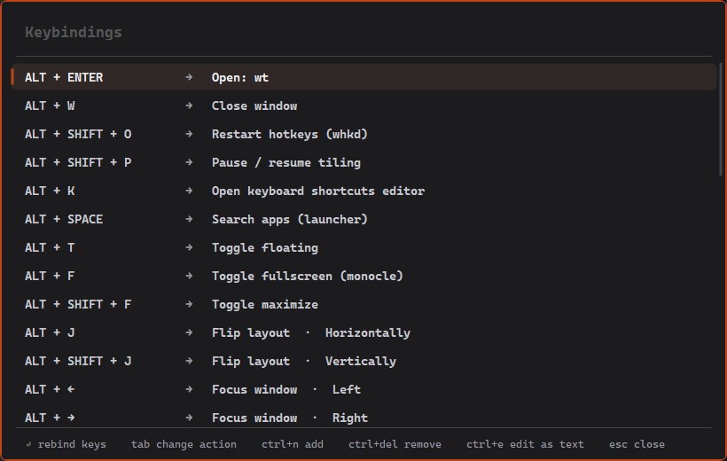
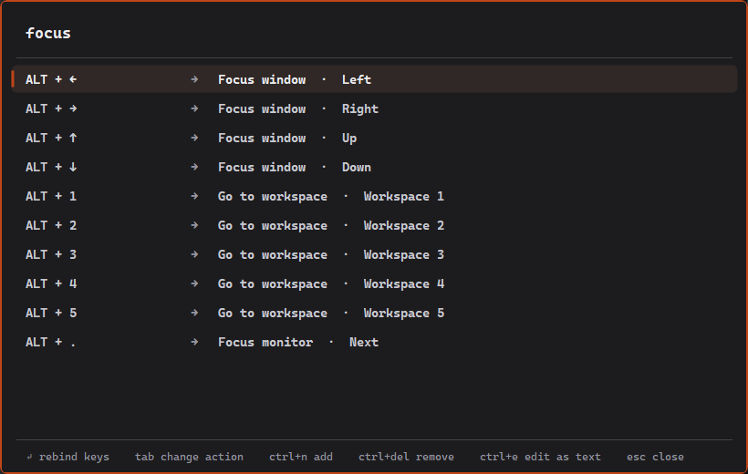
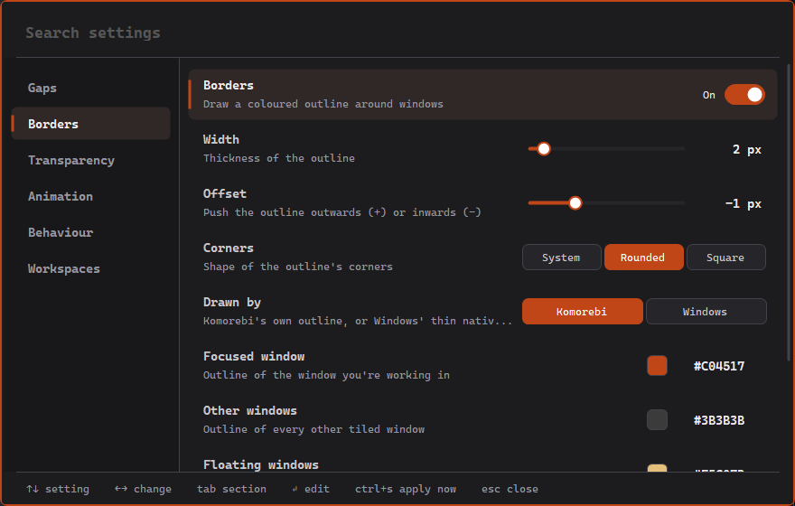
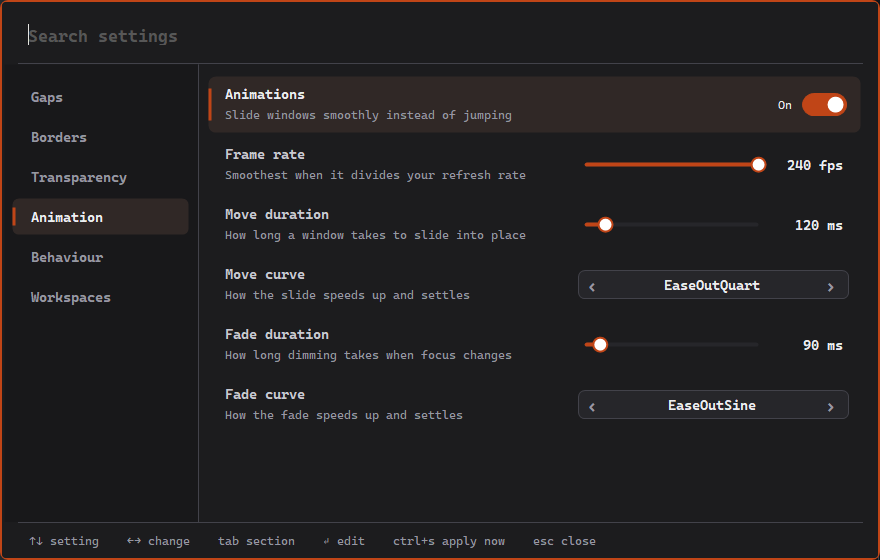
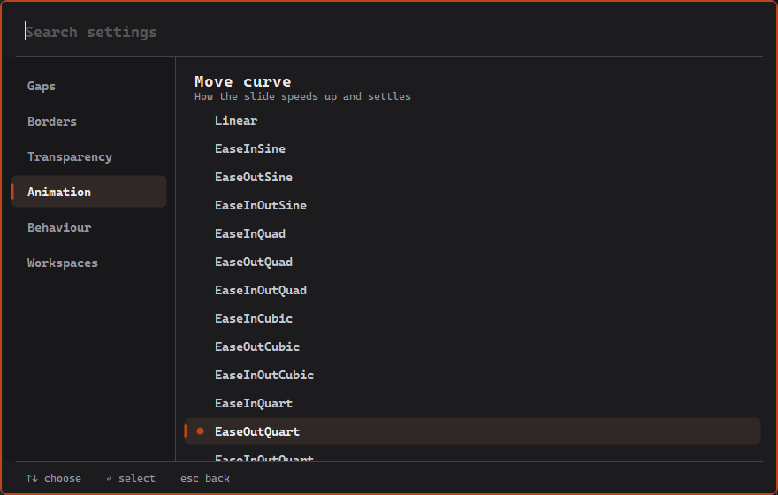
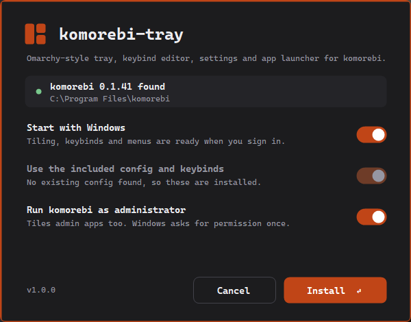
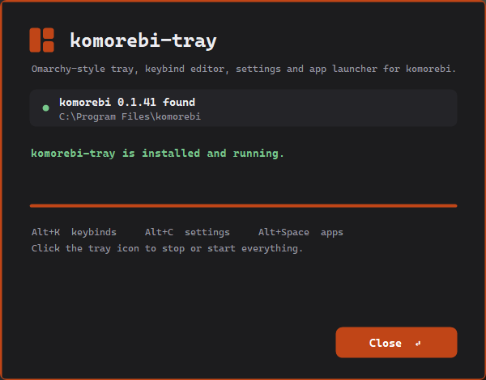

<p align="center">
  
</p>

<h1 align="center">komorebi-tray</h1>

<p align="center">
  An Omarchy-inspired companion for the <a href="https://github.com/LGUG2Z/komorebi">komorebi</a> tiling window manager on Windows:<br>
  built-in hotkeys, a keybind editor, a settings screen and an app launcher, all in one small tray app.
</p>

<p align="center">
  
</p>

> [!NOTE]
> **komorebi-tray is an unofficial add-on.** komorebi is created and maintained by [LGUG2Z](https://github.com/LGUG2Z) and contributors; this project is not affiliated with or endorsed by them.
> komorebi itself is **not modified and not included** here: the installer downloads it from its official winget package, and the tray only talks to it through komorebi's own `komorebic` command line.

## What it adds on top of komorebi

komorebi does the tiling. komorebi-tray wraps it in a keyboard-first desktop experience inspired by [Omarchy](https://omarchy.org):

| | Plain komorebi | With komorebi-tray |
|---|---|---|
| **Hotkeys** | A separate hotkey daemon (whkd or AutoHotkey) | Registered by the tray itself: one process, nothing to keep running alongside |
| **Changing keybinds** | Edit `whkdrc` by hand and restart whkd | **Alt+K**: a searchable list; press a new combo to rebind in place, pick actions from a menu |
| **Changing settings** | Edit `komorebi.json` by hand | **Alt+C**: a settings screen with switches, sliders and colour pickers; changes apply live |
| **Launching apps** | Start menu | **Alt+Space**: a launcher that searches every installed app, with icons, and keeps no history |
| **Turning it off** | `komorebic stop` (hotkeys keep running) | One click on the tray icon stops or starts *everything*: tiling, borders, hotkeys and menus |
| **Crashes** | Windows can be left semi-transparent or untileable | The tray clears leftover transparency and restarts komorebi automatically |
| **Admin apps** | Can't be tiled unless komorebi runs elevated | Optional admin mode, set up once by the installer; no UAC prompt at each start |
| **Look** | Your own config | A tuned default: gaps, rounded orange borders, focus transparency and smooth animations |

## Screenshots

**Alt+K: keybindings.** Type to filter. Press Enter on a row and then the new keys to rebind it; Tab changes what a shortcut does.



**Alt+C: settings.** Every komorebi.json option the tray knows, in plain English, grouped into sections. Dependent settings dim when their switch is off, and the search box finds anything across sections.







**The installer.**

 

## Install

1. Download **`komorebi-tray-setup.exe`** from the [latest release](../../releases/latest).
2. Run it (no admin needed) and choose **Install**.

The installer:

- installs komorebi from its official winget package (`LGUG2Z.komorebi`) if it isn't installed yet;
- copies the tray to `%USERPROFILE%\.config\komorebi\tray` and adds Start menu and (optionally) sign-in shortcuts;
- installs the default `komorebi.json` and keybinds when you have none, or, if you choose to, replaces yours after backing them up as `*.before-komorebi-tray-<date>`;
- can set up **admin mode** (a scheduled task that starts komorebi elevated, so it can also tile apps that run as administrator);
- registers itself in **Settings → Apps**, where you can uninstall it.

Running it again updates the tray and leaves your config alone unless you ask otherwise. For scripted installs: `komorebi-tray-setup.exe /S`.

> The exe isn't code-signed, so Windows SmartScreen may warn the first time ("More info → Run anyway"). All the source is in this repo, and you can build it yourself (below).

**Requirements:** Windows 10 or 11, 64-bit. .NET Framework 4.8 (built into Windows).

## Default keybinds

Mod key is **Alt** (Windows reserves most Win-key combos). Change any of them with **Alt+K**.

| Keys | Action |
|---|---|
| `Alt + Enter` | Open Windows Terminal |
| `Alt + Shift + Enter` | Open your default web browser |
| `Alt + Space` | App launcher |
| `Alt + K` | Keybind editor |
| `Alt + C` | Settings |
| `Alt + W` | Close window |
| `Alt + T` | Toggle floating |
| `Alt + F` | Toggle fullscreen (monocle) |
| `Alt + Shift + F` | Toggle maximize |
| `Alt + J` / `Alt + Shift + J` | Flip layout horizontally / vertically |
| `Alt + ←↑→↓` | Focus window |
| `Alt + Shift + ←↑→↓` | Move / swap window |
| `Alt + Ctrl + ←↑→↓` | Resize window |
| `Alt + B` / `G` / `V` / `Shift + C` | Layout: BSP / grid / vertical stack / columns |
| `Alt + 1…5` | Go to workspace |
| `Alt + Shift + 1…5` | Move window to workspace |
| `Alt + .` / `Alt + Shift + .` | Focus next monitor / move window to next monitor |
| `Alt + Shift + P` | Pause / resume tiling |
| `Alt + Shift + O` | Reload hotkeys |

Keybinds are stored in the standard whkd format at `%USERPROFILE%\.config\whkdrc`, so they stay readable and portable.

## Using it

- **Tray icon:** white while running, grey while stopped. Left-click stops or starts everything; right-click opens the menu (settings, keybinds, reload config, save diagnostics, quit).
- **Menus** (Alt+K, Alt+C, Alt+Space) fade in and out; press their shortcut again, Esc, or click away to close them.
- **Alt+C** saves when it closes and makes komorebi reload; **Ctrl+S** applies without closing, and **Ctrl+E** opens the raw `komorebi.json`. Each save keeps the previous file as `komorebi.json.bak`.
- **Command line:** `komorebi-tray.exe --shortcuts | --settings | --apps | --toggle-pause | --browser | --diagnostics` controls the running tray.

## Build from source

No SDK or Visual Studio needed: the build uses the C# compiler that ships with Windows.

```powershell
.\build.ps1
```

This produces `build\komorebi-tray.exe` and the installer `dist\komorebi-tray-setup.exe`, which embeds the tray, the icon and the files in `config\`.

| Path | What |
|---|---|
| `src\tray.cs` | The tray: hotkeys, menus, settings screen, launcher, komorebi supervision |
| `installer\Setup.cs` | The installer / uninstaller |
| `config\` | Default `komorebi.json` and `whkdrc` |
| `assets\` | Icon (`tools\make-icon.ps1` draws it) |

The tray idles at a few MB of memory with no CPU use: it waits on Windows events instead of polling.

## Troubleshooting

- **An app won't tile:** it's probably running as administrator. Enable admin mode in the installer (run it again), or start that app normally.
- **Windows stay semi-transparent or stop tiling after a crash:** click the tray icon twice (stop, then start). The tray clears leftover transparency and starts komorebi with a clean state.
- **A shortcut doesn't work:** another app already owns it. The tray names the conflict in a notification; rebind it with Alt+K.
- **Something else:** right-click the tray icon → *Save diagnostics*, which writes `diag.txt` next to your config.

## Credits

- **[komorebi](https://github.com/LGUG2Z/komorebi)** by [LGUG2Z](https://github.com/LGUG2Z) and contributors: the tiling window manager this project is built around. If you enjoy it, consider [sponsoring komorebi's development](https://github.com/sponsors/LGUG2Z). komorebi is licensed under the [Komorebi License](https://github.com/LGUG2Z/komorebi/blob/master/LICENSE.md).
- **[whkd](https://github.com/LGUG2Z/whkd)** by LGUG2Z: komorebi-tray reads and writes its keybind file format.
- **[Omarchy](https://omarchy.org)** by DHH: the inspiration for the look and the keyboard workflow.

## License

komorebi-tray's own code is released under the [MIT License](LICENSE). That covers only the code in this repository; komorebi and whkd keep their own licenses.
