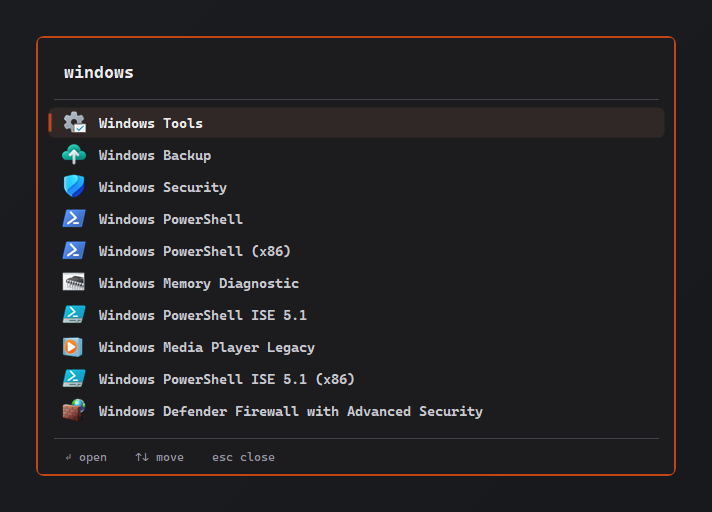
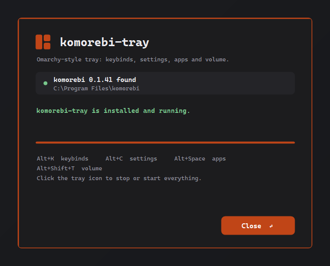

<p align="center">
  
</p>

<h1 align="center">komorebi-tray</h1>

<p align="center">
  An Omarchy-inspired companion for the <a href="https://github.com/LGUG2Z/komorebi">komorebi</a> tiling window manager on Windows:<br>
  built-in hotkeys, a keybind editor, a settings screen, an app launcher, a volume mixer and battery levels of your wireless devices, all in one small tray app.
</p>

<p align="center">
  
</p>

> [!NOTE]
> **komorebi-tray is an unofficial add-on.** komorebi is created and maintained by [LGUG2Z](https://github.com/LGUG2Z) and contributors; this project is not affiliated with or endorsed by them.
> komorebi itself is **not modified and not included** here: the installer downloads it from its official winget package, and the tray only talks to it through komorebi's own `komorebic` command line.

## What it adds on top of komorebi

komorebi does the tiling. komorebi-tray wraps it in a keyboard-first desktop experience inspired by [Omarchy](https://omarchy.org):

| | Plain komorebi | With komorebi-tray |
|---|---|---|
| **Hotkeys** | A separate hotkey daemon (whkd or AutoHotkey) | Registered by the tray itself: one process, nothing to keep running alongside |
| **Changing keybinds** | Edit `whkdrc` by hand and restart whkd | **Alt+K**: a searchable list; press a new combo to rebind in place, pick actions from a menu |
| **Changing settings** | Edit `komorebi.json` by hand | **Alt+C**: a settings screen with switches, sliders and colour pickers; changes apply live |
| **Launching apps** | Start menu | **Alt+Space**: a launcher that searches every installed app, with icons, and keeps no history |
| **Volume** | Windows' quick settings | **Alt+Shift+T**: a compact mixer for your output and every app playing sound, built into the tray |
| **Wireless batteries** | Vendor apps, one per brand | The level of every wireless mouse, keyboard, controller and headset as a small number next to the tray icon, read straight from the devices |
| **Turning it off** | `komorebic stop` (hotkeys keep running) | One click on the tray icon stops or starts *everything*: tiling, borders, hotkeys and menus |
| **Claude desktop** | Its frameless window is left floating | Tiled while you chat or code; tiling pauses while Claude controls the computer, so nothing fights its window |
| **Crashes** | Windows can be left semi-transparent or untileable | The tray clears leftover transparency and restarts komorebi automatically, and starts it again if it doesn't come up after sign-in |
| **Admin apps** | Can't be tiled unless komorebi runs elevated | Optional admin mode, set up once by the installer; no UAC prompt at each start |
| **Look** | Your own config | A tuned default: gaps, rounded orange borders, focus transparency and smooth animations. The focused border can follow your Windows accent colour |

## Screenshots

**Alt+K: keybindings.** Type to filter. Press Enter on a row and then the new keys to rebind it; Tab changes what a shortcut does.


**Alt+Shift+T: volume mixer.** In the same style as the other menus: the default output's level, output switch and mute, a rotary knob, and one slider per app.


**Alt+Space: app launcher.** Type a few letters of any installed app and press Enter. It shows icons and keeps no history.



**Alt+C: settings.** Every komorebi.json option the tray knows, in plain English, grouped into sections. Dependent settings dim when their switch is off, and the search box finds anything across sections.


**The installer.**

 

## Install

1. Download **`komorebi-tray-setup.exe`** from the [latest release](../../releases/latest).
2. Run it (no admin needed) and choose **Install**.

The installer:

- installs komorebi from its official winget package (`LGUG2Z.komorebi`) if it isn't installed yet;
- copies the tray to `%USERPROFILE%\.config\komorebi\tray` and adds Start menu and (optionally) sign-in shortcuts;
- installs the default `komorebi.json` and keybinds when you have none, or, if you choose to, replaces yours after backing them up as `*.before-komorebi-tray-<date>`;
- can set up **admin mode**: two on-demand scheduled tasks that start komorebi elevated (so it can also tile apps that run as administrator) and end it if it doesn't exit after a stop. Windows asks for permission once;
- registers itself in **Settings → Apps**, where you can uninstall it.

Running it again updates the tray and leaves your config alone unless you ask otherwise. For scripted installs: `komorebi-tray-setup.exe /S`.

> The exe isn't code-signed, so Windows SmartScreen may warn the first time ("More info → Run anyway"). All the source is in this repo, and you can build it yourself (below).

**Requirements:** Windows 10 or 11, 64-bit. .NET Framework 4.8 (built into Windows).

## Default keybinds

Mod key is **Alt** (Windows reserves most Win-key combos). Change any of them with **Alt+K**.

| Keys | Action |
|---|---|
| `Alt + Enter` | Open Windows Terminal |
| `Alt + Shift + Enter` | Bring your browser to the front (or start it, restoring your tabs) |
| `Alt + Space` | App launcher |
| `Alt + K` | Keybind editor |
| `Alt + C` | Settings |
| `Alt + W` | Close window |
| `Alt + T` | Toggle floating |
| `Alt + Shift + T` | Volume mixer |
| `Alt + F` | Toggle fullscreen (monocle) |
| `Alt + Shift + F` | Toggle maximize |
| `Alt + J` / `Alt + Shift + J` | Flip layout horizontally / vertically |
| `Alt + ←↑→↓` | Focus window |
| `Alt + Shift + ←↑→↓` | Move / swap window |
| `Alt + Ctrl + ←↑→↓` | Resize window |
| `Alt + B` / `G` / `V` / `Shift + C` | Layout: BSP / grid / vertical stack / columns |
| `Alt + 1…5` | Go to workspace |
| `Alt + Shift + 1…5` | Move window to workspace |
| `Alt + .` / `Alt + Shift + .` | Focus next monitor / move window to next monitor |
| `Alt + Shift + P` | Pause / resume tiling |
| `Alt + Shift + O` | Reload hotkeys |

Keybinds are stored in the standard whkd format at `%USERPROFILE%\.config\whkdrc`, so they stay readable and portable.

## Using it

- **Tray icon:** white while running, grey while stopped. Left-click stops or starts everything; right-click opens the menu (settings, keybinds, volume mixer, reload config, save diagnostics, quit).
- **Menus** (Alt+K, Alt+C, Alt+Space) fade in and out; press their shortcut again, Esc, or click away to close them.
- **Volume mixer** (Alt+Shift+T, or *Volume mixer* in the tray menu): opens at the top centre of the monitor your mouse is on (from the menu: under the tray icon). Drag the display, turn the knob (drag around it like a real knob, or scroll over it) to set the volume; the two buttons beside it switch to your next output and mute it. Each app playing sound gets its own slider; click its icon to mute it. Arrow keys adjust, M mutes, Esc or a click away closes it. It uses the same accent as the other menus (your Windows accent while *Match Windows accent* is on). Alt+C → Volume mixer chooses whether quiet apps are listed. It talks to Windows' audio directly and does nothing while closed.
- **Batteries:** each wireless device gets a small number next to the komorebi icon (hover it for the name; a battery mark means full). The number turns red at the low mark, blue while charging, and grey while the device sleeps (it then shows the last level it had). *Batteries* in the tray menu lists everything found, including devices that can't report a level and why. Alt+C → Batteries turns the numbers and the low-battery warning on or off and sets the low mark. Levels are read directly from the hardware every 30 s; no vendor software needs to run. Supported:
  - **Attack Shark / Delux mice** on their 2.4 GHz receiver (Xenta). Some models only report steps of 10%, shown as "about".
  - **AJAZZ / AULA keyboards** on their 2.4 GHz SONiX dongle (AK820, AK980; only while the keyboard is in 2.4 GHz mode).
  - **8BitDo and Nintendo pads in Switch mode** over Bluetooth (Pro Controller protocol, in 25% steps). On the 2.4 GHz dongle 8BitDo pads report no battery to the PC, so the menu says so instead of guessing.
  - **Logitech** (Unifying, Lightspeed and Bolt receivers, and Bluetooth), **Razer** wireless devices, **DualShock 4 / DualSense**, **Xbox controllers** (XInput levels), and **any Bluetooth device** Windows knows a level for.
  - `komorebi-tray.exe --batteries` prints one reading of everything to the console.
- **Keep videos solid** (Alt+C → Transparency, on by default) stops YouTube, Twitch and X from being dimmed when their browser window isn't focused, so a video you're watching on the side stays clear. It goes by the tab in front: a video tab behind another tab in the same window is dimmed like the rest. It covers all of X, not just its videos.
- **Games and fullscreen video:** while a fullscreen window is in front (no title bar, covering its whole monitor), the tray pauses its shortcuts, so keys like Alt+Enter reach the game instead of opening a terminal. They come back the moment you leave it. Turn this off in Alt+C → Behaviour → *Pause shortcuts in fullscreen*. komorebi itself never tiles, dims or draws over fullscreen windows, and neither it nor the tray hooks your keyboard or mouse, so there's no added input delay.
- **Match Windows accent** (Alt+C → Borders) gives the focused window's border, and the Alt+K, Alt+C and Alt+Space menus, your Windows accent colour, and follows it live when you change it in Settings → Personalization → Colors. Turning it off brings back the colour you had before. The choice is stored in `komorebi-tray.json` next to your config.
- **Alt+C** saves when it closes and makes komorebi reload; **Ctrl+S** applies without closing, and **Ctrl+E** opens the raw `komorebi.json`. Each save keeps the previous file as `komorebi.json.bak`.
- **Command line:** `komorebi-tray.exe --shortcuts | --settings | --apps | --volume | --toggle-pause | --browser | --diagnostics` controls the running tray; `--batteries` prints the battery levels.

## Build from source

No SDK or Visual Studio needed: the build uses the C# compiler that ships with Windows.

```powershell
.\build.ps1
```

This produces `build\komorebi-tray.exe` and the installer `dist\komorebi-tray-setup.exe`, which embeds the tray, the icon and the files in `config\`.

| Path | What |
|---|---|
| `src\tray.cs` | The tray: hotkeys, menus, settings screen, launcher, komorebi supervision |
| `installer\Setup.cs` | The installer / uninstaller |
| `config\` | Default `komorebi.json` and `whkdrc` |
| `assets\` | Icon (`tools\make-icon.ps1` draws it) |

The tray idles at a few MB of memory with no CPU use: it waits on Windows events instead of polling.

## Troubleshooting

- **An app won't tile:** it's probably running as administrator. Enable admin mode in the installer (run it again), or start that app normally.
- **Windows stay semi-transparent or stop tiling after a crash:** click the tray icon twice (stop, then start). The tray clears leftover transparency and starts komorebi with a clean state.
- **Claude desktop:** its window is frameless, so komorebi wouldn't tile it on its own. The tray hands Claude's main window to komorebi when it comes to the front, and leaves alone the click-through orange border Claude shows while it controls the computer, so that border stays full-screen above your tiles. While Claude is controlling the computer it stretches its own window over the screen, so the tray pauses tiling for that time and resumes it (every window back in its tile) when Claude is done; if you had paused tiling yourself, it stays paused. Don't add a `manage_rules` entry for `claude.exe`: it can't tell the two windows apart and would tile the border too, rearranging your windows under Claude's clicks.
- **Discord (or another Electron app) never looks dimmed:** it draws through DirectComposition, which ignores window transparency. For Discord, quit it fully (tray icon → Quit), open `%APPDATA%\discord\settings.json` and set `"chromiumSwitches": { "disable-direct-composition": "1" }`, then start it again. It keeps GPU acceleration.
- **A shortcut doesn't work:** another app already owns it. The tray names the conflict in a notification; rebind it with Alt+K.
- **Something else:** right-click the tray icon → *Save diagnostics*, which writes `diag.txt` next to your config.

## Credits

- **[komorebi](https://github.com/LGUG2Z/komorebi)** by [LGUG2Z](https://github.com/LGUG2Z) and contributors: the tiling window manager this project is built around. If you enjoy it, consider [sponsoring komorebi's development](https://github.com/sponsors/LGUG2Z). komorebi is licensed under the [Komorebi License](https://github.com/LGUG2Z/komorebi/blob/master/LICENSE.md).
- **[whkd](https://github.com/LGUG2Z/whkd)** by LGUG2Z: komorebi-tray reads and writes its keybind file format.
- **[Omarchy](https://omarchy.org)** by DHH: the inspiration for the look and the keyboard workflow.
- **Battery protocols:** the battery readers are written for this project from public protocol notes: [omarchy-delux-m900](https://github.com/AeonArcHQ/omarchy-delux-m900) and [BatteryTray](https://github.com/qu1ncky/BatteryTray) (Xenta receivers), [Nintendo Switch Reverse Engineering](https://github.com/dekuNukem/Nintendo_Switch_Reverse_Engineering) (Pro Controller), [sonix-keyboard-studio](https://github.com/donglover69/sonix-keyboard-studio) (SONiX dongles), [Solaar](https://github.com/pwr-Solaar/Solaar) and Logitech's HID++ 2.0 documents, [OpenRazer](https://github.com/openrazer/openrazer), and the Linux kernel's `hid-playstation` driver. The idea of a taskbar battery readout for every brand comes from [Wireless Battery](https://github.com/krisgfx9/Wireless-Device-Battery-Monitor) by krisgfx9.

## License

komorebi-tray's own code is released under the [MIT License](LICENSE). That covers only the code in this repository; komorebi and whkd keep their own licenses.
